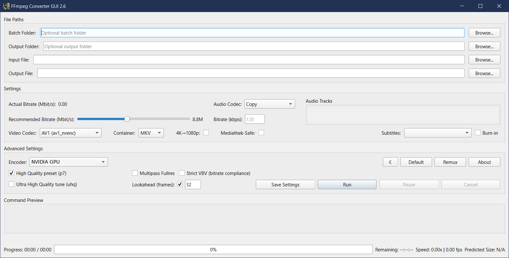
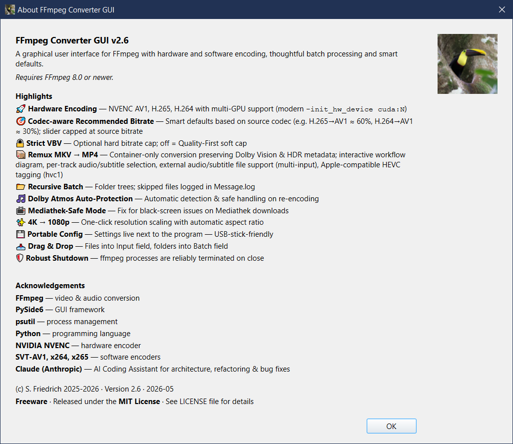

# FFmpeg Converter GUI

> A graphical user interface for FFmpeg — hardware-accelerated encoding (NVIDIA, AMD, Intel), smart batch processing, MKV → MP4 remuxing and Dolby Atmos protection. All in one window.

**Current version: 3.0.4** · Requires **FFmpeg 8.0+** · Windows (primary target), Linux from source



---

<a id="download"></a>

## ⬇️ Download / Quick Start (Windows)

No Python needed — the ready-to-run Windows build is included in this repository.

1. **Download the program:** [`FFmpeg_Converter_GUI_v.3.04.exe`](FFmpeg_Converter_GUI_v.3.04.exe) (≈ 24.5 MB, single file). On the file page, click *Download raw file*.
2. **Verify the download (recommended):** compare its SHA-256 hash with [`FFmpeg_Converter_GUI_v.3.04.sha256`](FFmpeg_Converter_GUI_v.3.04.sha256). In PowerShell, in the download folder:
   ```powershell
   Get-FileHash .\FFmpeg_Converter_GUI_v.3.04.exe -Algorithm SHA256
   ```
   The `Hash` value must match the hash in the `.sha256` file (case does not matter).
3. **Install FFmpeg 8.0 or newer** ([download](https://ffmpeg.org/download.html), e.g. the gyan.dev or BtbN Windows builds). Either add its `bin` folder to the system `PATH`, or put `ffmpeg.exe` and `ffprobe.exe` next to the EXE. Check with `ffmpeg -version`.
4. **Double-click the EXE.** No installation needed; settings are stored in `Converter_settings.json` next to the EXE.

> Windows SmartScreen may warn about an unknown publisher because the EXE is not code-signed. Verify the hash first, then choose *More info → Run anyway*.

Developers and Linux users: see [Run from Source](#run-from-source).

---

## ✨ Features

### 🚀 Hardware Encoding (NVIDIA, AMD, Intel)
- **NVIDIA NVENC** — `av1_nvenc`, `hevc_nvenc`, `h264_nvenc` (`-init_hw_device cuda:N`)
- **AMD AMF** — `av1_amf`, `hevc_amf`, `h264_amf` (`-init_hw_device d3d11va=amf_dev:N`)
- **Intel Quick Sync** — `av1_qsv`, `hevc_qsv`, `h264_qsv` (`-init_hw_device qsv=qsv_dev:hw_any`)
- **Software** — SVT-AV1, x265, x264, libvpx-vp9 (choose *CPU* in the *Encoder* dropdown)
- **Multi-GPU** — GPUs are detected via `nvidia-smi` (NVIDIA), WMI (AMD/Intel on Windows) or `lspci` (AMD/Intel on Linux) and listed in the *Encoder* dropdown
- **GPU capability filter** — only codecs the selected GPU can actually encode are offered (e.g. AV1 only on RTX 40+, Radeon RX 7000+, Arc A/B series; GPUs without an encoder such as GT 1030 or RX 6400/6500 fall back to software)
- NVENC quality tunings (preset `p7`, tune `uhq`, multipass `fullres`, `rc-lookahead`) are available for `av1_nvenc`; AMF/QSV use their driver defaults

### 🎯 Codec-aware Smart Bitrate
The recommended bitrate is calculated from source codec, target codec **and** resolution:

| Source → Target | H.264 | H.265 | AV1  |
|-----------------|-------|-------|------|
| **H.264**       | 0.50× | 0.35× | 0.30× |
| **H.265**       | 1.00× | 0.70× | 0.60× |
| **AV1**         | 2.00× | 1.20× | 0.80× |

Unknown source codecs fall back to 0.50×; VP9 sources are treated like H.265. Quality floors ensure a minimum bitrate per resolution and codec (e.g. AV1 @ 1080p ≥ 2.0 Mbps, AV1 @ 4K ≥ 6.0 Mbps) — but never above the source bitrate. The slider is capped at the source bitrate. Once you move the slider yourself, your value is kept for that file.

### 🔒 Strict VBV (optional)
- **Off (default):** `maxrate = 2 × target`, no `bufsize` — quality-first soft cap
- **On:** `maxrate = target`, `bufsize = 2 × target` — hard bitrate ceiling for streaming/broadcast targets

### 🗃️ Output Containers
Choose **MKV, MP4, MOV or WebM**. The codec dropdowns are filtered to what the container supports; if the current selection does not fit, the GUI offers to switch automatically (see [Supported Formats](#-supported-formats)).

### 📦 Remux MKV → MP4 — Container Swap & Audio Workshop
A dedicated dialog (**Remux** button) for container swaps, audio extraction and multi-channel downmixing — driven by a live workflow diagram. Details: [Remux_Documentation.md](Remux_Documentation.md).

- Video copied 1:1 — **Dolby Vision & HDR metadata preserved**
- Per-track audio and subtitle selection (automatic pre-selection per language); text subtitles are converted to `mov_text`
- External audio/subtitle files can be added as extra inputs (multi-input merge)
- Apple compatibility toggle (`hvc1` tag for HEVC)
- **Audio-only extraction** — untick *Include Video*; output as Copy (`.mka`), FLAC 24-bit (`.flac`), MP3 (`.mp3`) or AAC (`.m4a`)
- **Downmix** 5.1/7.1 → Stereo and 7.1 → 5.1 via explicit `pan` coefficients, with **Music** (ITU-R BS.775, LFE kept) and **Movie** (cinema-balanced) modes; only tracks with more channels than the target are re-encoded
- The dialog stays open after a remux, so several files can be processed in a row

### 🎵 Dolby Atmos Auto-Protection
Atmos tracks (TrueHD or E-AC-3 with Atmos/JOC in profile or tags) are detected automatically. The audio codec is then locked to **Copy** and all audio tracks are kept — no accidental downmix.

### 📂 Recursive Batch Processing
- Point the *Batch Folder* at a directory — all video files in all subfolders are processed (`.mp4 .mkv .avi .mov .webm .ts .m2ts .m4v`)
- Output is written next to each input file
- Existing outputs are **skipped**, not overwritten
- **Non-blocking errors (3.0.3):** a failing file no longer stops the batch with a dialog; the error is logged and the batch continues
- Every skip/error is written to a `Message.log` next to the affected input file (errors include the return code and the last 30 lines of FFmpeg output)
- If FFmpeg fails because a subtitle cannot be copied, the file is retried once without subtitle
- Completion toast with *encoded / skipped / failed* counts

### 🌙 Dark Mode
Live switch between light and dark theme (☾ / ☀ button, top right) — no restart needed; since 3.0.4 the switch takes effect on the first click. The choice is saved immediately to `Converter_settings.json`. The Remux dialog uses theme-matched accent colors (hints, warnings, links) and a theme-matched *Start Remux* button.

### 🪟 Resizable Window & Progress at a Glance (3.0.4)
- **Scroll area:** the whole main window content sits in a scroll area, so the window can be made shorter without clipping — a scrollbar appears when needed. Only the small top bar (💾 Save, ☾/☀ Theme, ⊟/⊞ Compact) stays fixed.
- **Compact button (⊟ / ⊞):** toggles the window height between full and about 50 %.
- **Window size and scroll position** are remembered in `Converter_settings.json` (on close and on *Save Settings*).
- **Save anywhere:** 💾 button in the top bar and **Ctrl+S**.
- **Windows taskbar progress:** green progress bar in the program's taskbar button (yellow while paused), so you can minimize the window during long encodes. The window title shows the percentage, too (e.g. `42% – FFmpeg Converter GUI 3.0.4`).
- **Tray icon with percentage:** while encoding, an icon next to the clock shows the percentage with a progress ring (green, yellow when paused); the tooltip shows remaining time. Clicking it brings the window back.

### 📺 Mediathek-Safe Mode
Fixes black-screen playback issues common with ARD/ZDF Mediathek downloads: regenerated timestamps (`-fflags +genpts`, `-avoid_negative_ts make_zero`), constant frame rate (`-fps_mode cfr`), 8-bit `yuv420p`, and for hardware encoders a fixed GOP plus profile/level. Auto-enabled for 10/12-bit and 4:2:2/4:4:4 sources; only available up to 8 Mbit/s. AV1 + Mediathek-Safe triggers a warning with the option to switch to H.265 or to force AV1 with BT.709 colour tags.

### ✨ 4K → 1080p Downscaling
One-click scaling to 1080p height with preserved aspect ratio (Lanczos). Sources of 1080p or less are left untouched.

### 💬 Subtitles
Select one subtitle stream to copy into the output, or **burn it in** (text-based subtitles only; picture-based PGS/DVB/DVD subtitles are marked `⚠ picture-based` and cannot be burned in).

### 💾 Portable Configuration
Settings are stored in `Converter_settings.json` **next to the program** — copy the folder to a USB stick and everything works. *Save Settings* stores encoder settings (no file paths); *Default* resets them.

### 📥 Drag & Drop
- Drag a **file** onto the window → sets the Input field
- Drag a **folder** onto the window → sets the Batch folder

### 🔍 Live Command Preview
The full FFmpeg command is shown in real time as you change settings.

---

## 📸 Screenshots

| Main Window | About |
|:-----------:|:-----:|
|  |  |

---

## 🛠️ Requirements

| Dependency | Version | Notes |
|------------|---------|-------|
| **FFmpeg** | ≥ 8.0 | Must be in system `PATH` or next to the EXE. [Download](https://ffmpeg.org/download.html) |
| **ffprobe** | ≥ 8.0 | Ships with FFmpeg |
| **Python** | ≥ 3.10 | Only needed when running from source (not for the EXE) |
| **PySide6** | ≥ 6.8 | LGPL — the theme switch uses `QStyleHints.setColorScheme()`, available since Qt 6.8 |
| **psutil** | ≥ 5.9 | Pause/resume and reliable process shutdown |

For hardware encoding you also need a current NVIDIA, AMD or Intel graphics driver and an FFmpeg build with NVENC/AMF/QSV support (e.g. the gyan.dev or BtbN Windows builds).

> **Note:** The GUI is built against FFmpeg 8.0 syntax (`-init_hw_device`, `-fps_mode`). It does not check the installed FFmpeg version itself — run `ffmpeg -version` to verify.

---

## 🚀 Getting Started

End users: see [Download / Quick Start](#download) — just run the included EXE.

### Run from Source
For developers, or on Linux (taskbar progress is Windows-only; everything else works).

```bash
# Clone the repository
git clone https://github.com/WaveboSF/FFmpeg-Converter-GUI.git
cd FFmpeg-Converter-GUI

# Install Python dependencies
pip install -r Requirements.txt

# Run
python ffmpeg_converter_gui.py
```

The optional icons are loaded from `resources/icons/` — `logo.png` (About dialog) and `logo_styled.ico` (window/taskbar icon). They are not included in this repository; the app runs without them.

Verify the source with [`ffmpeg_converter_gui.sha256`](ffmpeg_converter_gui.sha256) (see [Verifying Downloads](#verify)).

### Build the EXE yourself
The released EXE is built with [Nuitka](https://nuitka.net/). The original build scripts (`build_nuitka.bat`, `build_nuitka_onefile.bat`) are not part of this repository. A minimal single-file build:

```bat
pip install nuitka ordered-set zstandard
python -m nuitka --onefile --enable-plugin=pyside6 ffmpeg_converter_gui.py
```

Add `--file-version=3.0.4.0 --product-version=3.0.4.0` (plus `--windows-icon-from-ico=…` and console options as desired) to match the release build.

---

## 🎬 Supported Formats

### Video Codecs
| Codec | NVIDIA | AMD | Intel | Software |
|-------|:------:|:---:|:-----:|:--------:|
| AV1   | ✅ av1_nvenc | ✅ av1_amf | ✅ av1_qsv | ✅ libsvt-av1¹ |
| H.265 | ✅ hevc_nvenc | ✅ hevc_amf | ✅ hevc_qsv | ✅ libx265 |
| H.264 | ✅ h264_nvenc | ✅ h264_amf | ✅ h264_qsv | ✅ libx264 |
| VP9   | ❌ | ❌ | ❌ | ✅ libvpx-vp9 |

¹ SVT-AV1 is offered next to the GPU encoders; in *CPU* mode it is disabled (too slow for practical use).

### Audio Codecs
Copy · AAC · AC-3 · E-AC-3 · MP3 · Opus · FLAC · Vorbis

### Container Formats

| Container | Video Codecs | Audio Codecs |
|-----------|-------------|--------------|
| **MKV** | AV1, H.265, H.264, VP9 | Copy, AAC, AC-3, E-AC-3, MP3, Opus, FLAC, Vorbis |
| **MP4** | AV1, H.265, H.264 | Copy, AAC, AC-3, E-AC-3, MP3, Opus, FLAC |
| **MOV** | H.265, H.264 | Copy, AAC, AC-3, MP3 |
| **WebM** | AV1, VP9 | Opus, Vorbis |

---

## 📁 Repository Contents

```
FFmpeg-Converter-GUI/
├── FFmpeg_Converter_GUI_v.3.04.exe      # Ready-to-run Windows build (v3.0.4)
├── FFmpeg_Converter_GUI_v.3.04.sha256   # SHA-256 of the EXE
├── ffmpeg_converter_gui.py              # Current source (v3.0.4)
├── ffmpeg_converter_gui.sha256          # SHA-256 of the current source
├── Requirements.txt                     # Python dependencies
├── Changelog.md                         # Version history
├── Remux_Documentation.md               # Remux dialog documentation (current)
├── screenshoot.png, screenshoot_about.png
├── .gitignore
└── LICENSE                              # MIT
```

The repository contains only the current version; older sources and builds were removed.

`Converter_settings.json` (next to the program) and `Message.log` (next to batch input files) are created at runtime.

---

## 📚 Documentation

| Document | Description |
|----------|-------------|
| [Changelog.md](Changelog.md) | Version history |
| [Remux_Documentation.md](Remux_Documentation.md) | Remux dialog: container swap, audio extraction & downmix |

---

## 📝 Changelog

See [Changelog.md](Changelog.md) for the full history. Recent highlights:

- **v3.0.4** *(current)* — Scrollable/resizable main window with Compact button, Windows taskbar progress, tray icon with percentage, theme-matched Remux dialog
- **v3.0.3** — Non-blocking batch errors (logged to `Message.log`), encoded/skipped/failed summary
- **v3.0.2** — Subtitle crash fix with auto-retry, `OverflowError` fix for files > 2 GB
- **v3.0** — AMD AMF & Intel QSV support, multi-vendor GPU detection, Remux downmix (Music/Movie)
- **v2.6** — PySide6 migration & Dark Mode
- **v2.5** — FFmpeg 8.0 modernization, Remux dialog, codec-aware bitrate, multi-GPU

---

<a id="verify"></a>

## ⚙️ Verifying Downloads (SHA-256)

Each file has a `.sha256` next to it (`sha256sum` format, `<hash> *<filename>`, CRLF line endings).

```powershell
# Windows (PowerShell)
Get-FileHash .\FFmpeg_Converter_GUI_v.3.04.exe -Algorithm SHA256
Get-FileHash .\ffmpeg_converter_gui.py -Algorithm SHA256
```

```bash
# Linux / macOS / Git Bash
sha256sum -c FFmpeg_Converter_GUI_v.3.04.sha256
sha256sum -c ffmpeg_converter_gui.sha256
```

Compare the PowerShell `Hash` value with the hash in the matching `.sha256` file.

---

## 📄 License

Freeware — released under the [MIT License](LICENSE). Free for personal and commercial use.

| Component | License |
|-----------|---------|
| FFmpeg | GPL / LGPL |
| PySide6 | LGPL v3 |
| Python | PSF License |
| psutil | BSD-3-Clause |
| Nuitka *(build-time only)* | Apache 2.0 |

---

## 🙏 Acknowledgements

- [FFmpeg](https://ffmpeg.org/) — the engine behind everything
- [NVIDIA NVENC](https://developer.nvidia.com/video-codec-sdk), [AMD AMF](https://github.com/GPUOpen-LibrariesAndSDKs/AMF), Intel Quick Sync — hardware encoding
- [SVT-AV1](https://gitlab.com/AOMediaCodec/SVT-AV1), [x264](https://www.videolan.org/developers/x264.html), [x265](https://x265.readthedocs.io/) — software encoders
- [PySide6 / Qt for Python](https://doc.qt.io/qtforpython/) — GUI framework
- [Claude (Anthropic)](https://www.anthropic.com/) — AI coding assistant for architecture, refactoring & bug fixes

---

*Author: WaveboSF · FFmpeg ≥ 8.0 required*
